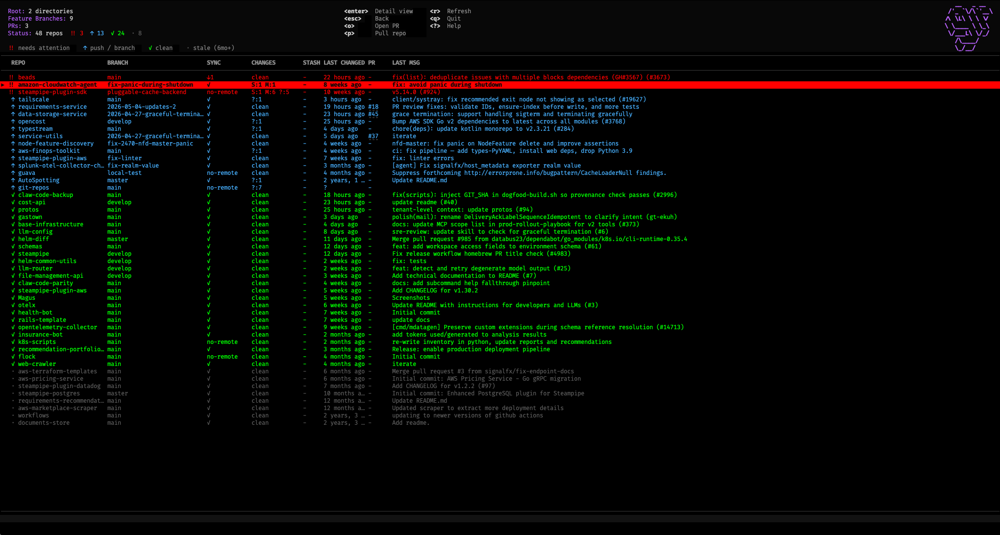

# git-repos

I have a lot of git repos. At any given moment some of them have uncommitted work, some are behind remote, some have an open PR I forgot about. Switching between them to check is tedious, and `git status` only tells you about the one you're in.

`git-repos` scans a directory of repos and shows you everything at once: what branch you're on, whether you're ahead or behind remote, staged/modified/untracked files, stash count, last commit, and any open GitHub PRs, all in a single table.

Because the binary is named `git-repos`, Git treats it as a subcommand automatically, so you can just type `git repos`.

Interactive TUI by default, plain text or JSON when you need to pipe it.

```text
ST  REPO              BRANCH            SYNC    CHANGES       LAST CHANGED  PR   LAST COMMIT
─────────────────────────────────────────────────────────────────────────────────────────────
 !  my-api            feature/auth      ↑2↓1    S:1 M:3       2h ago        #42  fix token refresh
 ↑  frontend          feature/dash      ↑3      ?:2           yesterday     #38  add skeleton
 ✓  infra             main              ✓       clean         3d ago        -    bump terraform
 ·  old-service       main              ✓       clean         8mo ago       -    initial commit
```

Status icons:

- `!` — needs attention: dirty working tree or behind upstream
- `↑` — needs a push, or you're on a non-main branch
- `✓` — clean and in sync on main/master
- `·` — stale, no commits in 6+ months

## Screenshot of TUI Mode



### Acknowledgements

The TUI aesthetic was shamelessly inspired by [k9s](https://k9scli.io/), the wonderful Kubernetes terminal UI. If you haven't used it, you're missing out.

## Install

### Homebrew (recommended)

```bash
brew install samsar/tap/git-repos
```

### Go

```bash
go install github.com/samsar/git-repos@latest
```

Make sure `$(go env GOPATH)/bin` is on your `$PATH`.

### Build from source

```bash
git clone https://github.com/samsar/git-repos
cd git-repos
go build -o git-repos .
mv git-repos /usr/local/bin/
```

## Usage

```bash
git repos                        # scan configured directory
git repos ~/projects             # scan a specific directory
git repos --fetch ~/projects     # git fetch in every repo first (slower but accurate)
git repos --no-prs               # skip GitHub PR lookup
git repos --plain                # plain text, no TUI
git repos --json                 # JSON output
```

The first time you run it without arguments, it'll ask which directory to scan and save that to `~/.config/git-repos/config.json`. You can also manage this manually:

```bash
git repos config add ~/projects
git repos config add ~/work
git repos config show
git repos config reset
```

## Requirements

- Go 1.27+ (only if building from source)
- `git` on your PATH
- [`gh`](https://cli.github.com/) on your PATH and authenticated — only needed for PR lookup, everything else works without it

## TUI keys

### Navigation

| Key                   | Action                |
| --------------------- | --------------------- |
| `j` / `k` or arrows   | Move up/down          |
| `g` / `G` or Home/End | Jump to top/bottom    |
| `Ctrl+f` / `Ctrl+b`   | Page down/up          |
| `Enter`               | Open repo detail view |
| `Tab`                 | Switch to the PR page |
| `Esc`                 | Back to list          |

### Actions

| Key | Action                             |
| --- | ---------------------------------- |
| `p` | Pull (git fetch) the selected repo |
| `v` | View the repo's PR in your browser |
| `e` | Open the repo in your editor       |
| `E` | Pick an editor to open the repo in |
| `r` | Refresh all repos (runs fetch)     |
| `?` | Toggle help overlay                |
| `q` | Quit                               |

### Sorting (press again to reverse)

| Key | Sort by      |
| --- | ------------ |
| `0` | Status       |
| `N` | Name         |
| `B` | Branch       |
| `S` | Sync         |
| `C` | Changes      |
| `T` | Last changed |
| `P` | PR           |

### Changing keys

Every key above is a default. To change one from the TUI, open the help (`?`), select the action with `j`/`k`, press `r`, then the new key. A free key is saved at once; one another action already has is offered as a swap. `backspace` puts the selected action back to its default.

Or give any action keys of your own in `~/.config/git-repos/config.json`, by its name:

```json
{
  "dirs": ["/Users/you/projects"],
  "keys": {
    "search": "f",
    "pull_all": "ctrl+u",
    "move_down": ["j", "down"]
  }
}
```

A key is a character (`a`, `A`, `?`), a named key (`enter`, `tab`, `up`, `f1`), or ctrl with a letter (`ctrl+d`). `[]` leaves an action without a key. `ctrl+c` always quits and `esc` always goes back. Keys are per view (the list, the detail view, settings), so one key can mean different things in different views, but only one thing in each.

```bash
git repos keys          # every key, view by view, with action names and yours marked
git repos keys --free   # the keys still free in each view
git repos keys check    # check config.json's keys: unknown names, keys bound twice, …
```

If config.json's keys have a problem, the TUI uses the default keys and says so in its status bar.

## PR page

`Tab` switches between your repos and a page of every open PR on your GitHub account: yours, and those asking for your review, each in a section of its own, both at once. `f` shows only yours, only those asking for your review, or both again. Each PR shows its checks, its review decision, when it was last updated, and whether you have it cloned (`cloned`) or checked out (`✓ here`) in the directories git-repos scans. Its status icon reads like the repos': `!` checks failing or changes requested, `↑` checks running or a review to come, `✓` ready, `·` draft.

`Enter` opens the PR's local clone in the detail view (`Esc` comes back), `v` views the PR in your browser, `e`/`E` open its clone in your editor, `/` searches by repo, number, title, branch or author, and `r` looks them up again. The PRs come from one GitHub query through `gh`, the same one that fills the repo list's PR column, which shows a PR, yours or asking for your review, for the branch each repo has checked out.

## Opening a repo in your editor

`e` opens the selected repo in your default editor; `E` lists the editors to pick one. git-repos offers the editors and agents it finds on your PATH (Cursor, VS Code, Zed, Sublime Text, Claude Code, Codex, Neovim, Vim) and a shell in a new terminal window. Each opens one of three ways:

- **gui**: as an app beside git-repos, which keeps running
- **inline**: here, in git-repos's terminal, which comes back when you exit (vim, nvim)
- **tab**: in a new tab of the terminal window git-repos runs in, which keeps a shell in the repo once the command exits (claude, codex)
- **window**: the same in a new terminal window (a shell)

Tabs and windows open in Ghostty or iTerm2 on macOS; Terminal opens a window for a tab, since its scripting can't open tabs, and inside tmux both open a tmux window. In any other terminal they open inline instead, unless you give the command that opens one (below). Pick the default in settings (`z`), or in config.json, which also adds or changes editors:

```json
{
  "default_editor": "cursor",
  "editors": [
    {"name": "cursor", "cmd": ["cursor", "{path}"]},
    {"name": "nvim", "cmd": ["nvim", "."], "mode": "inline"},
    {"name": "claude", "cmd": ["claude", "--continue"], "mode": "tab"}
  ],
  "terminal": ["wezterm", "start", "--cwd", "{path}", "--", "{cmd}"]
}
```

`{path}` is the repo's directory, which is also where the command runs; in `terminal`, `{cmd}` is the editor's command. An editor of yours replaces the preset of its name. `git repos editors` lists them, and where windows open.

## Flags

| Flag         | Description                                                                |
| ------------ | -------------------------------------------------------------------------- |
| `--fetch`    | Run `git fetch --prune` before scanning (slower, catches upstream changes) |
| `--no-prs`   | Skip GitHub PR lookup                                                      |
| `--no-color` | Disable color output                                                       |
| `--plain`    | Plain text instead of TUI                                                  |
| `--json`     | JSON output                                                                |

## Releasing

1. Ensure all changes are merged to `main`.
2. Tag and push:

   ```bash
   git tag v<x.y.z>
   git push origin main --tags
   ```

3. The [release workflow](.github/workflows/release.yml) fires automatically, builds binaries for all platforms, publishes a GitHub Release, and updates the Homebrew formula in `samsar/homebrew-tap`.
